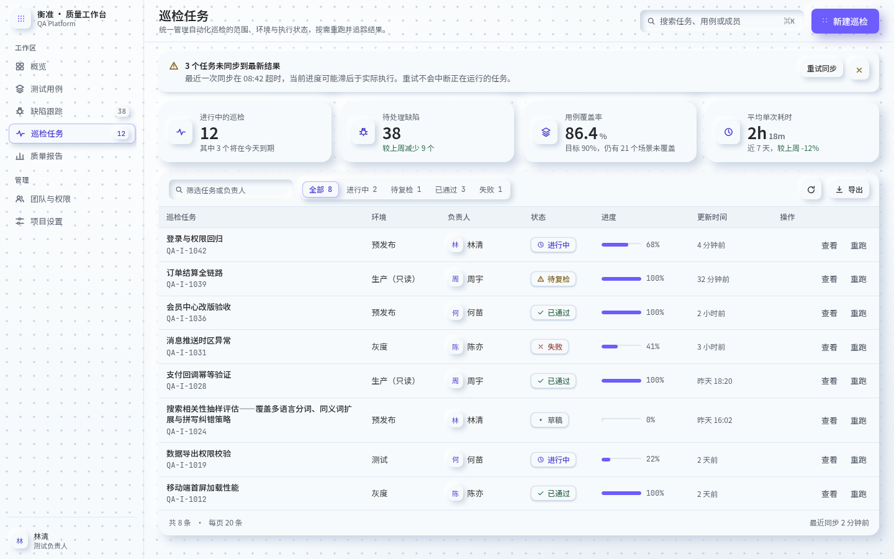
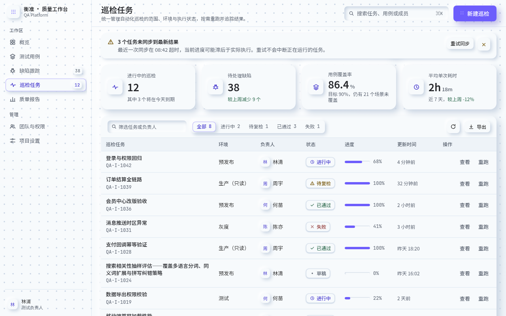
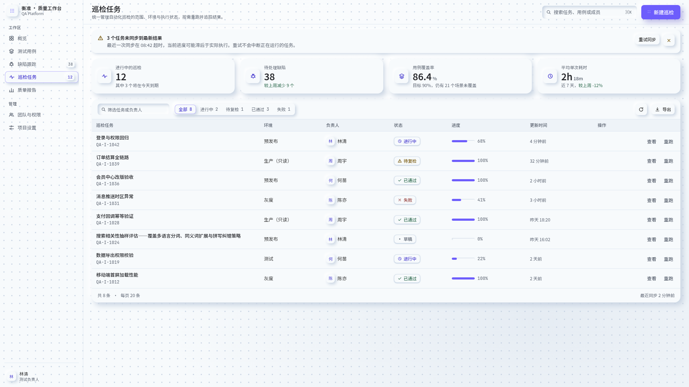
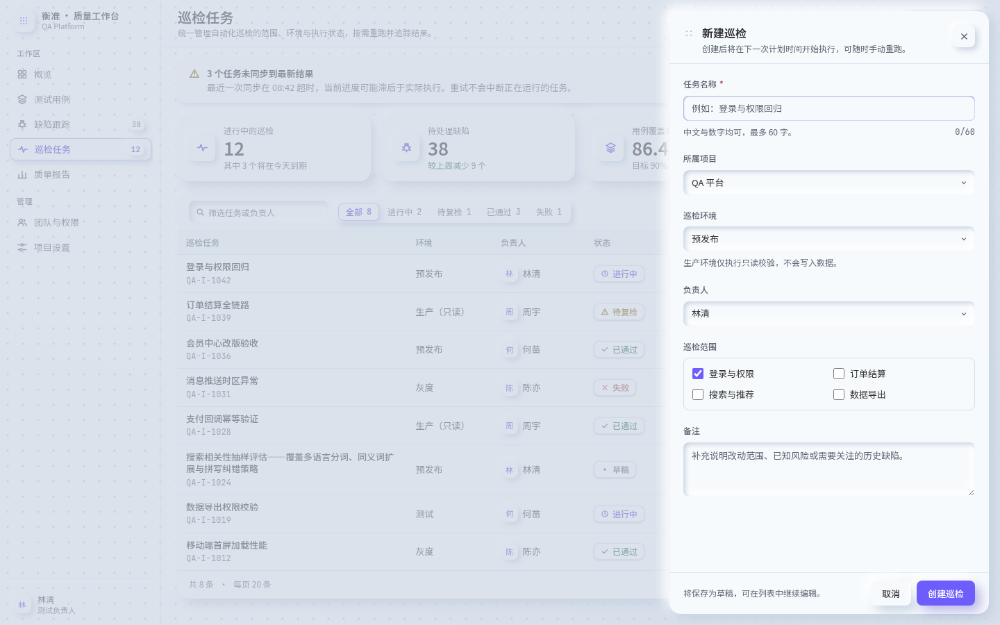
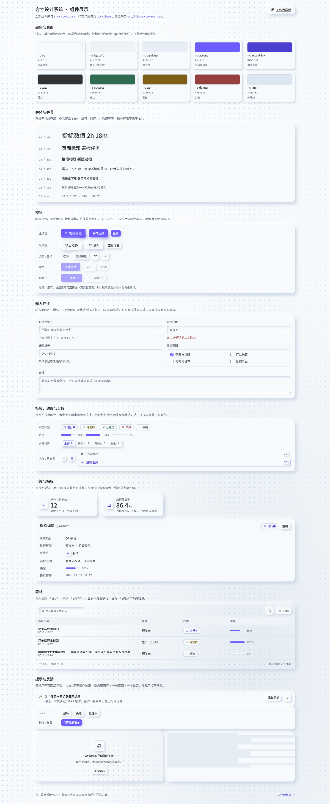

# 方寸 · 个人桌面端设计系统

一套从真实项目里长出来的浅色新拟物视觉系统：**方正小圆角、22px 点阵底纹、克制的靛紫强调色、轻微双向阴影、适合长时间盯屏的内容区**。它同时是一份可运行的工作台样板、一套 `ds-` 前缀的通用组件、一份 Pencil 设计源文件，和一份给 AI Agent 用的规则集。

- 样板页（业务示例）：`index.html` —「衡准 · 质量工作台 / 巡检任务」
- 组件展示（通用示例）：`examples/components.html`
- 规范文档：`DESIGN.md`（视觉规则与验收数据）、`docs/`（接入与迁移）
- 设计源文件：`design/design.pen` + `design/design-previews/`

## 视觉特点

| 特征 | 做法 |
| --- | --- |
| 方正、小圆角 | 控件 8px、徽标 6px、卡片 16px、进度槽胶囊；没有全圆角按钮 |
| 点阵 | 页面底纹为 22px 单色点阵（两层柔光叠出左上亮、右下暗）；点阵图标只出现在品牌标记、主按钮与抓手上 |
| 克制的强调色 | 只有 `#6d5dfc` 与它的深色 `#4b3fd0`；渐变仅作为阴影的高光/暗部，不铺在内容区 |
| 轻微阴影 | 凸起 `8/8/16`，小控件 `4/4/8`，输入内凹 `3/3/6 + -6/-6/12`，聚焦收到 `1/2` |
| 长时间使用 | 正文 14px、辅助 12–13px，正文对比度 12:1，最弱文字也守 4.5:1 |

## 目录结构

```
index.html                 工作台样板页（业务内容，可整体替换）
src/
  tokens/tokens.css        设计变量（颜色/字号/间距/圆角/阴影/层级/点阵），作用域 .ds-theme
  theme/base.css           基础样式：字体栈、页面底纹、焦点环、.ds-mono / .ds-sr-only
  theme/index.css          一次性引入变量 + 基础 + 组件
  ui/ui.css                通用组件样式（.ds- 前缀，跨项目复用主体）
  ui/ui.js                 DS.toast() / DS.drawer()（原生 JS，无依赖）
  ui/icons.js              18 个线性图标 symbol（构建时或运行时注入）
  app/workspace.css        样板页布局（业务）
  app/workspace.js         样板页交互（业务，模拟请求）
  index.js                 ESM 入口：注入图标 + 导出 DS
examples/
  components.html          组件展示页（色板、排版、按钮全状态、表单、表格、反馈）
  gallery.css / .js        展示页布局与演示交互
design/
  design.pen               Pencil 设计源文件（视觉基准）
  design-previews/         工作台 / 抽屉 / 组件 / 状态四张导出图
  design-assets/bg-dot.png 画板背景素材（页面用 CSS 点阵还原）
docs/
  integration.md           新项目接入（安装、引入、示例、冲突、版本）
  migration.md             已有项目逐页迁移
  screenshots/             三视口 × 三状态截图
skills/design-system/      AI Agent 规则（SKILL.md）
tools/verify.mjs           自检：布局、对比度、组件样式、键盘、交互
tools/screenshot.mjs       生成 docs/screenshots
DESIGN.md                  设计规范与验收记录
CHANGELOG.md               版本与变更记录
```

## 环境与命令

需要 Node ≥ 18（自检脚本用原生 `fetch` 与 `WebSocket`）和本机 Chrome/Chromium（可用 `CHROME_BIN` 指定）。项目本身零依赖、无构建步骤。

```bash
npm start                 # python3 -m http.server 8000，打开 http://localhost:8000
npm run verify            # 49 项检查：三视口溢出、对比度、样式抽查、键盘、抽屉/筛选/空态/加载/失败 toast
npm run screenshot        # 重新生成 docs/screenshots（1x，三视口 × 工作台/抽屉/组件页）
```

直接双击 `index.html` 也能跑，但 `file://` 下字体与截图脚本行为略有差异，验收请用本地服务器。

## 设计变量与使用

变量全部在 `.ds-theme` 作用域内定义（不在 `:root`），所以可以只让页面的一部分换肤：

```html
<body class="ds-theme">
```

```css
/* 覆盖重点色，不碰组件样式 */
.ds-theme {
  --c-accent: #4f7cff;
  --c-accent-ink: #2f56c8;
}
```

主要 token（完整表见 `DESIGN.md` §2）：

```css
--c-bg: #f7fafc;      --c-bg-soft: #eef3f8;   --c-bg-deep: #e7eef6;
--c-accent: #6d5dfc;  --c-accent-ink: #4b3fd0;
--c-text: #333333;    --c-text-strong: #26272b; --c-text-muted: #5b6370; --c-text-faint: #5c6472;
--c-line: #dde7f1;    --c-success: #2f6b4f;   --c-warn: #7d5f16;   --c-danger: #96403e;
--r-xs: 6px; --r-sm: 8px; --r-md: 10px; --r-lg: 12px; --r-xl: 16px;
--sp-1: 4px … --sp-8: 48px;
--sh-raised / --sh-raised-xs / --sh-inset-sm / --sh-input / --sh-track
--z-scrim: 40; --z-drawer: 50; --z-toast: 60;
```

组件用法（按钮、表单、标签、表格、抽屉、Toast、图标）都在 `docs/integration.md` §4，可直接复制。

## 新项目接入

```bash
npm install file:../self-ui-style#v0.4.1     # 或 git+ssh://…/self-ui-style.git#v0.4.1
```

```js
import '@self/ui-style/theme.css';
import { DS } from '@self/ui-style';
```

```html
<body class="ds-theme"> … <button class="ds-btn ds-btn-primary">保存</button> … </body>
```

固定版本、子树导入、纯 HTML 引用、React/Vue/SSR 差异、样式冲突处理见 **`docs/integration.md`**。

## 已有项目逐页迁移

原则：一次一页、由外到内、每层截图对比、业务语义不动。顺序与冲突处理见 **`docs/migration.md`**。

## Skill（给 AI Agent）

位置：`skills/design-system/SKILL.md`。适用于「用这套视觉做页面 / 给已有项目接入 / 迁移某页」的任务。

使用方式：把该目录放进 Agent 的 skills 路径（例如项目内 `.pi/skills/` 或用户级 skills 目录），Agent 在相关任务里会自动读取；也可以直接对 Agent 说「按 design-system skill 做」。它要求 Agent：先读目标项目技术栈 → 加载本系统主题与参考页 → 优先用现有组件、新增组件沿用变量 → 保留目标项目业务语义 → 先迁一页验证 → 处理样式冲突 → 跨技术栈只复用 tokens 与规格，不硬套组件代码。

## 设计稿与实现的对应关系

| 设计（`design/design.pen` 画板） | 实现 |
| --- | --- |
| 巡检任务 · 质量工作台（1440×900） | `index.html` + `src/app/workspace.css` |
| 新建巡检 · 抽屉 | `index.html` 的 `#drawer` + `DS.drawer` |
| 组件规范 | `src/ui/ui.css`、`examples/components.html` |
| 状态与反馈 | `DS.toast`、`.ds-empty`、`.ds-skeleton`、`.ds-banner`、`examples/components.html#feedback` |

数值以 `src/tokens/tokens.css` 为准；`design/` 里的 PNG 是设计期导出，页面已改用 CSS 复刻点阵底纹（不再引用 PNG）。

### 已采纳的实现取舍

- **长标题行**：设计稿任务行高 55px，但两行标题会溢出；网页让该行自动增高（示例约 72px），避免内容重叠，保证完整可读。
- **字体**：维持 Google Fonts 在线加载 Noto Sans SC / JetBrains Mono，并保留系统字体回退。暂不内嵌字体文件；离线时字宽可能略有差异。若项目需要离线运行或跨设备截图一致，再评估许可并加入 WOFF2 子集。
- **按需扩展**：深色主题、行选择/批量操作/表头吸顶，以及更细的 Pencil 组件资产拆分，当前不纳入基础系统；有项目需求时再实现。
- **截图**：保留 1280×800、1440×900、1920×1080 三种视口，便于持续核对布局；当前体积可接受，后续优先无损压缩。

## 截图

工作台（1440×900）：



1280×800 与 1920×1080：





抽屉展开（1440×900）：



组件展示（1440×900，整页）：



其余视口的同名文件：

| 视口 | 工作台 | 抽屉 | 组件页 |
| --- | --- | --- | --- |
| 1280×800 | `workspace-1280x800.png` | `workspace-drawer-1280x800.png` | `components-1280x800.png` |
| 1440×900 | `workspace-1440x900.png` | `workspace-drawer-1440x900.png` | `components-1440x900.png` |
| 1920×1080 | `workspace-1920x1080.png` | `workspace-drawer-1920x1080.png` | `components-1920x1080.png` |

## 验证状态

已在本机 Chromium（headless，CDP 驱动）实际跑过 `npm run verify`，**49/49 通过**：

- 三视口 × 两个页面：无横向溢出、主操作可见、无 console 错误；变量只在 `.ds-theme` 内生效。
- 对比度：正文 12.05、标题 14.23、次要 5.78、辅助 5.69、主按钮白字 4.54、强调文字 6.86、状态色 6.00 / 5.69 / 6.46。
- 样式抽查：按钮 8px 圆角与外阴影、输入内凹、标签描边浮起、卡片 8/16、点阵来自 CSS、过渡 0.3s。
- 键盘：Tab 有 2px 强调色焦点环；抽屉打开聚焦首字段、Esc 关闭并回焦触发按钮、Tab 不逃逸。
- 交互：空名校验、保存后插入新行 + 成功 toast、状态筛选、搜索空态、刷新骨架、导出失败 toast 可重试、组件页分段/Toast/抽屉。

尚未验证：

- 真实后端接口（页面用 `setTimeout` 模拟）、真实生产数据量下的表格性能。
- Safari / Firefox、Windows 字体渲染、高对比模式与屏幕阅读器实测。

## 已知限制与按需扩展

- 当前仅提供浅色主题；深色主题需重新校准双光源与阴影。
- 新拟物本身对比度偏低，本系统把最弱文字守在 4.5:1；对低视力用户建议额外提供高对比模式。
- 通用表格不含行选择、批量操作或表头吸顶；这些能力由具体业务需要时再扩展。
- 抽屉/Toast 是 DOM 工具，不含虚拟列表或动画编排。

## 版本维护

当前版本 **0.4.1**（见 `package.json` 与 `CHANGELOG.md`）。项目侧用 `file:` 或 Git tag 固定版本；升级时先在一个代表性页面替换并截图对比，再推广。修改 tokens 或组件后请更新 `CHANGELOG.md` 并跑 `npm run verify` 与 `npm run screenshot`。

## 许可

个人项目，MIT。
